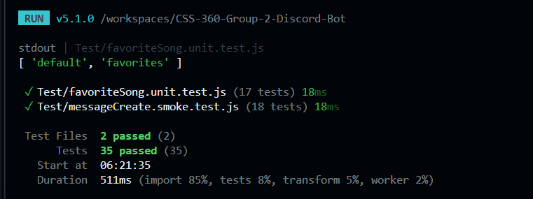

## 3. Cohesion and Coupling (Jack Jiang)

### Method

I read every file in `src/` on two branches: `main` and `feature/gemini-api`, which is the branch we run for demos. I used `npx madge --json src` to map which files import which, and I listed the outside packages and APIs each file depends on. Numbers below are from `feature/gemini-api` unless noted.

I rated each module with these definitions:

- **Cohesion** is how closely the code inside one module belongs together. *Functional* cohesion means the module does one job, which is best. *Logical* cohesion means unrelated jobs are grouped only because they look alike, which is weak.
- **Coupling** is how much one module depends on others. *Data* coupling means modules share only simple values, which is best. *Common* coupling means modules share global data, and *external* coupling means a module depends directly on outside systems. Both are weak.
- **Fan-in** is how many of our modules use a module. **Fan-out** is how many modules and outside packages it uses.


### Architecture overview

The bot has four layers. `app.js` creates the Discord client. `helpers/loadEvents.js` reads every file in `events/` and registers it. Each file in `events/` handles one Discord event. `services/gemini.js` talks to the Gemini API.

### Module ratings

| Module | Main job | Lines | Fan-in | Fan-out | Cohesion | Coupling |
| --- | --- | --- | --- | --- | --- | --- |
| app.js | Create client, start loader | 20 | 0 | 3 (discord.js, helpers, path) | Functional | Low |
| helpers/loadEvents.js | Register event files | 29 | 1 | 3 (loadFiles, ascii-table, path) | Functional | Low |
| helpers/loadFiles.js | List files in a folder | 7 | 1 | 1 (fs) | Functional | Low |
| services/gemini.js | Send a prompt to Gemini | 46 | 1 | 1 (Gemini API) | Functional | Low, data only |
| events/ready.js | Log when the bot is online | 15 | 0 | 0 | Functional | Low |
| events/guildMemberAdd.js | Welcome new members | 57 | 0 | 1 (discord.js) | Functional | Low |
| events/favorite-song.js | Save and list favorites | 60 | 0 | 0 | Functional | Low |
| events/messageCreate.js | Six text commands | 273 | 0 | 4 (gemini, axios, discord.js, iTunes API) | **Logical** | **High** |

Seven of eight modules are small and focused. Almost all of the weakness sits in one file.

### Findings

1. **Low cohesion in `messageCreate.js`.** One `execute` function handles hello, ping, help, `/song`, `/similar`, and `/ai`. These jobs share nothing except that they start from a chat message, which is logical cohesion. The function has 16 `if` checks, 4 `try` blocks, and about 19 calls to Discord. It is 273 lines on our branch and grows to 378 lines on `main` once `/play` is added. Every new command makes the function longer, and editing one command means scrolling through and risking all the others.
2. **High coupling to outside services.** `messageCreate.js` has the highest fan-out in the bot. It builds iTunes requests with axios, reads the raw iTunes response fields, writes the Gemini prompt, and formats Discord embeds, all in the same place. On `main` it also imports `@discordjs/voice`, ffmpeg, and `child_process`. If the iTunes response format changes, the command handler has to change too. This is external coupling.
3. **Good example: `services/gemini.js`.** It has functional cohesion and data coupling. It takes a string and returns a string, and it hides the URL, the API key, the timeout, and the response parsing. Both `/similar` and `/ai` reuse it, and the model could be changed in one place. This is the pattern the rest of the bot should follow.
4. **Good example: the event loader.** `loadEvents.js` registers any file placed in `events/`, so `app.js` does not need to know which events exist. Adding a new event file needs no change anywhere else. This keeps coupling between the startup code and the features low.

### Recommendation

Split `messageCreate.js` into one handler per command and keep `messageCreate.js` as a small router. Move the iTunes calls into an `itunesService.js`, following the same pattern as `gemini.js`. Move pure logic, such as building prompts and turning an iTunes result into an embed, into functions that take plain values. A possible structure:

```
src/
├── commands/        one file per command: song.js, similar.js, ai.js, help.js
├── services/        gemini.js, itunes.js
├── utils/           embeds.js, prompts.js
└── events/          messageCreate.js only routes to commands/
```

This would turn the one logical module into several functional modules, cut the fan-out of the router to one, and let each command be tested on its own.

## 4. Test Coverage (Jack Jiang)

### Method

I searched both branches for test files, test frameworks, and test scripts. Then I measured coverage across all source files with:

```
npx c8 --all --src src --include 'src/**' -r text node -e ""
```

The `--all` flag lists every source file, even files no test has touched. I also checked the GitHub Actions workflow for a test step.

### Result: 0% coverage on both branches

Neither branch has a `tests` folder or any test file. On our branch, `package.json` still has the template's `test` script, which runs mocha on `tests/*.spec.js`, and mocha and chai are installed. But `npm test` fails because there are no files to run. On `main`, there is no `test` script at all. The GitHub Actions workflow builds and pushes a Docker image but never runs tests.


### What this means

None of our features are checked automatically. If a change breaks a command, nobody finds out until a user tries it in Discord. The bot also depends on two outside APIs, Gemini and iTunes, and without tests we have no record of how it should behave when they are slow, return nothing, or return an error. Every one of those cases is a branch in the code, and 0% branch coverage means none of them have been checked.

### Testability by module

The cohesion and coupling results explain why coverage is hard to raise. Focused modules are easy to test, and the large mixed module is not.

| Module | How easy to test | Why |
| --- | --- | --- |
| helpers/loadFiles.js | Easy | Pure function, can use a temp folder |
| services/gemini.js | Easy | Takes a string, returns a string; mock `fetch` |
| events/ready.js | Easy | Pass a fake client and check the log |
| events/favorite-song.js | Medium | Needs a fake message, but logic is short |
| events/guildMemberAdd.js | Medium | Needs a fake member and channel; output is random |
| events/messageCreate.js | Hard | Six commands in one function; needs a fake message, fake axios, and fake Gemini for every test |

### Where to start

Tests should go first where a failure would hurt users most:

1. **`services/gemini.js`**: two commands depend on it. Test a normal reply, a missing API key, an error status, and an empty reply.
2. **`/song` in `messageCreate.js`**: it is the most complex command. Test an empty song name, no iTunes results, a missing preview, and a network error.
3. **`favorite-song.js`**: test saving, viewing an empty list, and viewing a full list.

A realistic first goal is 30% line coverage, focused on these three areas. After the refactor suggested above, each command could be tested on its own, and a goal of 70% would be reasonable.

### Recommendation

Use the existing mocha and chai setup, and add c8 to the `test` script so every run prints a coverage report. Mock `askGemini` and axios so tests never call real APIs. Then add `npm test` to the GitHub Actions workflow so every push is checked, and fail the build if coverage drops below the agreed goal.

## 7. Smoke Test (Tyler M) 

### Purpose

This test challenges `src/events/messageCreate.js` across all of its commands and performs a broad, shallow check of every command from end to end without touching any real services. This smoke test only seeks to determine if the `messageCreate.js` executes at its most basic level for every command without crashing. It confirms that each feature responds correctly to normal input and bad input. This test catches breaks after a change.   

### Function

The test mocks all external dependencies (Gemini AI, axios/iTunes API, @discordjs/voice, child_process, ffmpeg-static) so nothing joins a real voice channel, touches the network, or launches an audio process. The `makeMessage()` helper builds a mock message object with the properties the file uses (content, author.bot, reply, channel.send, guild.channels.cache.get), and the fakeTrack object is sent to iTunesAPI for an iTunes result. Each test mock's behavior then determines what the file did: what replies were sent, which functions were called, and which were not called. 

### Tests 

| Area | Behaviors Tested | 
| --- | --- | 
| Event Definition | The export has `name === messageCreate` and `execute` is a function |
| Filtering | Bot messages and unrelated commands/messages get no reply |
| Basic Commands | `hello` -> "Welcome", `ping` -> "Pong" (case-insensitive), `help` -> "Available Commands" |
| `/song` | Missing argument prompt, successful iTunes lookup (correct API URL and search term, embed with preview), no results, Does API handle failure correctly |
| `/play` | Joins voice channel once and announces the song, no playable track and does not join, missing voice channel |
| `/similar` | Missing argument, Gemini is called with the song name and results are sent as "Similar songs", Gemini failure |
| `/ai` | Missing argument, Gemini answer is returned as a reply, long answers split into chunks, Gemini failure |

### Results

The test ran 18 tests in 18ms with most time spent importing (86%) rather than running tests (4%). Every command path in messageCreate.js, including the error paths, behaves as intended. 



### Recommendations

- Change the voice channel ID from a fixed ID to using the requestor's channel instead for the `/play` command. A fixed ID limits the bot to only joining the 'lounge' channel. The bot can prompt the requestor to join a voice channel first (if they aren't already in one) before the bot plays the song. This will also make the error "I couldn't find that voice channel!" more meaningful.
- Each command also has its own error message. A wrapper around the dispatcher ensures an unexpected throw never goes unanswered or crashes the listener.
- The services that are integrated into messageCreate.js can also be split into their own services folder (services/itunes.js, services/gemini.js). This can also be applied to the other functions (commands/song.js, commands/play.js, command/help.js). 

## 8. Unit Test - `favorite-song.js` (Tyler M)

### Purpose

This test checks that the favorites feature is correct in isolation. `viewFavorites` and `saveFavorite` store and display the correct requested songs, ignores bot messages, ignores the wrong arguments, and keeps each user's list separate. 

### Function
- `makeMessage()` builds a fake Discord message, a `reply` function, `client.user.id` (the bot's ID), and `channel.message.fetch` returning an original message.
- `botSong()` builds the bot's original message, optionally from a different bot ID.
- `beforeEach` calls `faovrites.clear()`, so state refreshes between tests.
- Each test calls `event.execute(message)` and responds to replies, receives the call, and maps contents.

### Tests

| Area | Case Tests | 
| --- | --- |
| Event Definition | `name === "messageCreate"`
| Filtering | Ignores bot messages and non-commands |
| `viewFavorites` | No entry entered, empty array, numbered lists, whitespace trimming, per-user isolation |
| `saveFavorite` (Success) | Message retrieved from user, does content save, confirms with "Added to your favorites!" |
| `saveFavorite` (Rejections) | No reply from user, is the message from a bot, empty or whitespace | 
| Data Behavior | Multiple saves accumulated, users stay separate, save and review |

### Results

The test ran 17 tests in 14ms with most time spent importing (86%) rather than tests (4%). Every command, including error paths, behave as intended. However the source code shows some problems the tests don't catch, and a couple of passing tests are hiding them. 


### Recommendation

- `favorite-song.js` runs `favorites.set(userId, [])` before checking whether the message is a reply, whether the original is from the bot, or whether it has content. Every rejected `/saveFavorite` command leaves `favorites.get(userId) === []`. Every invalid entry is entered as a [] entry. This issue could impact memory if the user enters a large number of empty or invalid entries.
- There are silent failures. Not replying to a message, replying to a user's message, or replying to the bot's embed-only message (empty `content`) all produce no response. Users may think the command is broken. The tests show "no reply" as the default response.
- There is strict command matching. `content === "viewFavorites"` is case-sensitive, so `/viewFavorites` is ignored, and other handler lowercases its commands. The commands also can't have any trailing text or spaces.
- The same song can be saved repeatedly because the list unbounded, and there's no `/removeFavorite` or `clearFavorites` command.
- `/viewFavorites` can exceed Discord's 2000-character limit. A user with a long favorites list will get a failed reply and an unhandled rejection.
- All favorites also vanish on every restart or redeployment of the bot


